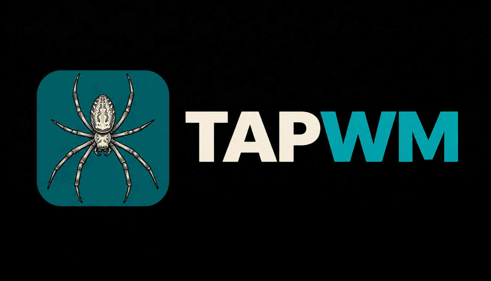
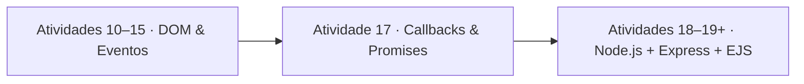
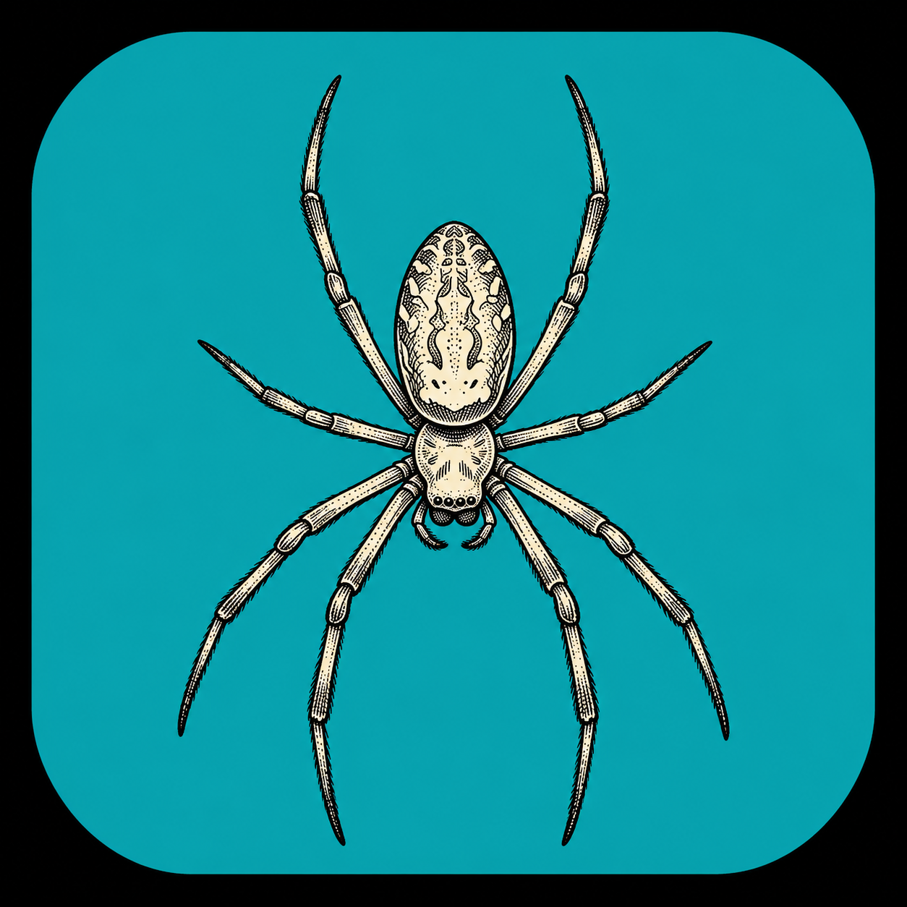

<a id="top"></a>

<p align="center"><sub>TAPWM</sub></p>

---

<p align="center"></p>

<p align="center">Atividades de programação web, DOM, eventos, código assíncrono e aplicações com Express.</p>

<p align="center">


</p>

<p align="center"><a href="#visão-geral">Visão geral</a> &nbsp;·&nbsp; <a href="#como-executar">Como executar</a></p>

<a id="explore-o-projeto"></a>

<a id="por-onde-começar"></a>

## Por onde começar

- **[Navegador](Atividade%2010/index.html)**, exemplo inicial de atividade web.
- **[Assíncrono](Atividade%2017)**, exercícios de JavaScript assíncrono.
- **[Servidor](Atividade%2018/app.js)**, aplicação Node.js da atividade 18.

<a id="visão-geral"></a>

<a id="sobre-o-projeto"></a>

## Sobre o projeto

O repositório **TAPWM** reúne a coleção progressiva de projetos práticos desenvolvidos ao longo da disciplina de programação web na **Fatec Sorocaba**. A estrutura de pastas acompanha a evolução técnica do curso, começa com lógica, objetos e eventos interativos no navegador (Atividades 10 a 15), avança para programação assíncrona com *Callbacks* e *Promises* em JavaScript (Atividade 17) e culmina na construção de aplicações servidoras com **Node.js, Express e views EJS** (Atividades 18 em diante).

<a id="principais-módulos-e-atividades"></a>

## Principais módulos e atividades

| Atividade | Foco técnico implementado |
|---|---|
| **Atividades 10 e 11** | Funções, objetos em JavaScript e manipulação estruturada de elementos HTML. |
| **Atividade 12** | Eventos de mouse e troca dinâmica de estados visuais (janela aberta, fechada e quebrada). |
| **Atividades 13, 14 e 15** | Validação de formulários, transformação de textos e scripts modulares separados (script.js). |
| **Atividade 17** | Execução assíncrona no Node.js explorando *Callbacks*, leitura de arquivos e *Promises* (exercicio4Apromises.js). |
| **Atividades 18 e 19+** | Servidor HTTP com **Express**, roteamento modular, motor de templates **EJS** e recarregamento automático com **Nodemon**. |

<a id="arquitetura-da-trilha"></a>

## Arquitetura da trilha



<a id="estrutura-do-repositório"></a>

## Estrutura do repositório

```text
TAPWM/
├── assets/
│   └── identity/banner.png               Banner do projeto
├── Atividade 10/ a Atividade 15/   Páginas interativas em HTML, CSS e JavaScript
├── Atividade 17/                   Exercícios de Callbacks e Promises para Node.js
├── Atividade 18/ & Atividade 19/   Aplicações web em Node.js, Express e EJS
└── README.md
```

<a id="como-executar"></a>

## Como executar

### Atividades Front-End (10 a 15)
Abra o arquivo index.html da atividade desejada diretamente no navegador.

### Atividades Node.js e Express (17, 18 e 19)
```bash
git clone https://github.com/arthurlynow098/TAPWM.git
cd "TAPWM/Atividade 18"
npm install
npm start
```

<p align="center">
  <a href="https://github.com/arthurlynow098">GitHub</a> &nbsp;·&nbsp;
  <a href="https://arthurentsev.vercel.app/">Portfólio</a> &nbsp;·&nbsp;
  <a href="https://www.linkedin.com/in/entsevarthur/">LinkedIn</a>
</p>

<a id="identidade-e-créditos"></a>

## Identidade e créditos

<table><tr><td width="150"></td><td><strong>Aranha</strong><br>Construção de conexões, em referência à web.<br><br><a href="assets/identity-v2/logo.png">Logo em PNG</a> · <a href="assets/identity-v2/banner.png">Banner em PNG</a></td></tr></table>

A gravura do banner é a tarântula de Carl Wilhelm Hahn, de 1833, em domínio público no [Wikimedia Commons](https://commons.wikimedia.org/wiki/File%3AHahn_1833_Die_Arachniden_fig._73a_Lycosa_tarantula.jpg).

<p align="center"><a href="#top">Voltar ao topo ↑</a> · <a href="https://github.com/arthurlynow098">Arthur Entsev</a> · <a href="https://arthurentsev.vercel.app/">Portfólio</a></p>
