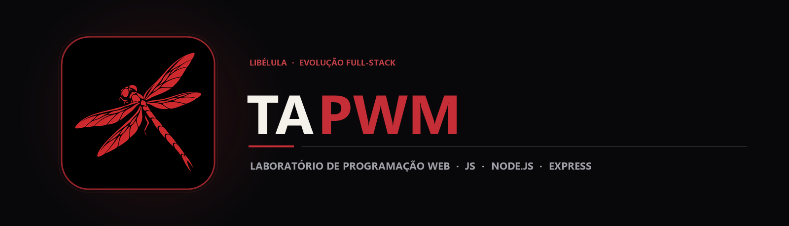

  

  Trilha prática de Programação Web evoluindo da manipulação de DOM e eventos no navegador até servidores em Node.js, Express e EJS.

  
  
  

## Sobre o projeto

O repositório **TAPWM** reúne a coleção progressiva de projetos práticos desenvolvidos ao longo da disciplina de programação web na **Fatec Sorocaba**. A estrutura de pastas acompanha a evolução técnica do curso: começa com lógica, objetos e eventos interativos no navegador (Atividades 10 a 15), avança para programação assíncrona com *Callbacks* e *Promises* em JavaScript (Atividade 17) e culmina na construção de aplicações servidoras com **Node.js, Express e views EJS** (Atividades 18 em diante).

## Principais módulos e atividades

| Atividade | Foco técnico implementado |
|---|---|
| **Atividades 10 e 11** | Funções, objetos em JavaScript e manipulação estruturada de elementos HTML. |
| **Atividade 12** | Eventos de mouse e troca dinâmica de estados visuais (janela aberta, fechada e quebrada). |
| **Atividades 13, 14 e 15** | Validação de formulários, transformação de textos e scripts modulares separados (script.js). |
| **Atividade 17** | Execução assíncrona no Node.js explorando *Callbacks*, leitura de arquivos e *Promises* (exercicio4Apromises.js). |
| **Atividades 18 e 19+** | Servidor HTTP com **Express**, roteamento modular, motor de templates **EJS** e recarregamento automático com **Nodemon**. |

## Tecnologias

  
  
  
  

## Arquitetura da trilha

`mermaid
flowchart LR
    A[Atividades 10–15 · DOM & Eventos] --> B[Atividade 17 · Callbacks & Promises]
    B --> C[Atividades 18–19+ · Node.js + Express + EJS]
`

## Estrutura do repositório

`	ext
TAPWM/
├── assets/
│   ├── banner.png                  Banner principal TAPWM
│   └── project-animal.png          Símbolo da libélula
├── Atividade 10/ a Atividade 15/   Páginas interativas em HTML, CSS e JavaScript
├── Atividade 17/                   Exercícios de Callbacks e Promises para Node.js
├── Atividade 18/ & Atividade 19/   Aplicações web em Node.js, Express e EJS
└── README.md
`

## Executando o código

### Atividades Front-End (10 a 15)
Abra o arquivo index.html da atividade desejada diretamente no navegador.

### Atividades Node.js e Express (17, 18 e 19)
`ash
git clone https://github.com/arthurlynow098/TAPWM.git
cd "TAPWM/Atividade 18"
npm install
npm start
`

---

Estudo · construção · evolução <a href="https://github.com/arthurlynow098">Perfil</a> · <a href="https://arthurentsev.vercel.app/">Portfólio</a> · <a href="https://www.linkedin.com/in/entsevarthur/">LinkedIn</a>

