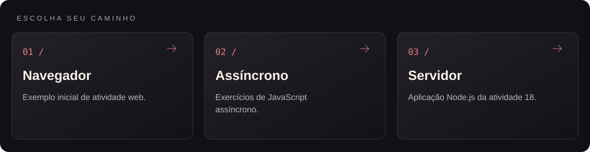
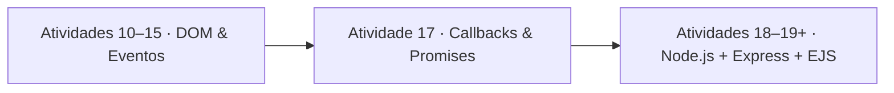

<p align="center">
  
</p>

<p align="center">Atividades de programação web: DOM, eventos, código assíncrono e aplicações com Express.</p>

<p align="center"></p>

<p align="center"><a href="#visão-geral">Visão geral</a> &nbsp;·&nbsp; <a href="#como-executar">Como executar</a></p>

---

<a id="explore-o-projeto"></a>




<table width="100%">
<tr><th align="left">Área</th><th align="left">O que você encontra</th><th align="left">Acesso direto</th></tr>
<tr><td><strong>Navegador</strong></td><td>Exemplo inicial de atividade web.</td><td><a href="Atividade%2010/index.html">Abrir navegador →</a></td></tr>
<tr><td><strong>Assíncrono</strong></td><td>Exercícios de JavaScript assíncrono.</td><td><a href="Atividade%2017">Abrir assíncrono →</a></td></tr>
<tr><td><strong>Servidor</strong></td><td>Aplicação Node.js da atividade 18.</td><td><a href="Atividade%2018/app.js">Abrir servidor →</a></td></tr>
</table>

<a id="visão-geral"></a>


O repositório **TAPWM** reúne a coleção progressiva de projetos práticos desenvolvidos ao longo da disciplina de programação web na **Fatec Sorocaba**. A estrutura de pastas acompanha a evolução técnica do curso: começa com lógica, objetos e eventos interativos no navegador (Atividades 10 a 15), avança para programação assíncrona com *Callbacks* e *Promises* em JavaScript (Atividade 17) e culmina na construção de aplicações servidoras com **Node.js, Express e views EJS** (Atividades 18 em diante).

<a id="principais-módulos-e-atividades"></a>


| Atividade | Foco técnico implementado |
|---|---|
| **Atividades 10 e 11** | Funções, objetos em JavaScript e manipulação estruturada de elementos HTML. |
| **Atividade 12** | Eventos de mouse e troca dinâmica de estados visuais (janela aberta, fechada e quebrada). |
| **Atividades 13, 14 e 15** | Validação de formulários, transformação de textos e scripts modulares separados (script.js). |
| **Atividade 17** | Execução assíncrona no Node.js explorando *Callbacks*, leitura de arquivos e *Promises* (exercicio4Apromises.js). |
| **Atividades 18 e 19+** | Servidor HTTP com **Express**, roteamento modular, motor de templates **EJS** e recarregamento automático com **Nodemon**. |

<details>
<summary>Arquitetura da trilha</summary>



</details>

<details>
<summary>Estrutura do repositório</summary>

```text
TAPWM/
├── assets/
│   └── banner-v2.png               Banner do projeto
├── Atividade 10/ a Atividade 15/   Páginas interativas em HTML, CSS e JavaScript
├── Atividade 17/                   Exercícios de Callbacks e Promises para Node.js
├── Atividade 18/ & Atividade 19/   Aplicações web em Node.js, Express e EJS
└── README.md
```

</details>

<a id="como-executar"></a>


### Atividades Front-End (10 a 15)
Abra o arquivo index.html da atividade desejada diretamente no navegador.

### Atividades Node.js e Express (17, 18 e 19)
```bash
git clone https://github.com/arthurlynow098/TAPWM.git
cd "TAPWM/Atividade 18"
npm install
npm start
```

---

<p align="center">
  <a href="https://github.com/arthurlynow098">GitHub</a> &nbsp;·&nbsp;
  <a href="https://arthurentsev.vercel.app/">Portfólio</a> &nbsp;·&nbsp;
  <a href="https://www.linkedin.com/in/entsevarthur/">LinkedIn</a>
</p>
